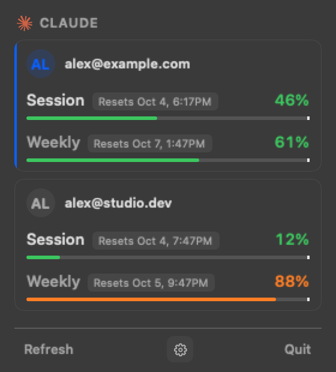

# Claudex

Claudex is a macOS menu bar app that shows the 5-hour and weekly limits of your
Claude accounts.

It reads them from [CLIProxyAPI](https://github.com/router-for-me/CLIProxyAPI), which owns
sign-in, credentials and account rotation. Claudex only displays.

<p align="center">
  
</p>

## Install

Requires Apple silicon, macOS 14 Sonoma or newer, and CLIProxyAPI running on
`http://127.0.0.1:8317` with its management API enabled:

```sh
brew install cliproxyapi
brew services start cliproxyapi
```

Claudex reads the management key from `CLIPROXY_MGMT` in `~/.cli-proxy-api-secrets.env`.
Set `CLIPROXY_URL` to point it at another address.

### Homebrew

Recommended. Two commands on first install:

Homebrew 7 asks you to trust third-party casks first. Trust only Claudex:

```sh
brew trust --cask itizarsa/tap/claudex
brew install --cask itizarsa/tap/claudex
```

Then open Claudex from Applications.

### mise

mise installs the same Homebrew cask. Add Claudex to `mise.toml`:

```toml
[bootstrap.packages]
"brew-cask:itizarsa/tap/claudex" = "latest"
```

Install it:

```sh
mise bootstrap packages apply --manager brew-cask
```

### First launch warning

Claudex is self-signed, not notarized. The Homebrew cask clears its quarantine flag,
so Homebrew and mise installs open without a prompt.

A zip downloaded in a browser is quarantined, and macOS shows:

> Apple could not verify "Claudex.app" is free of malware.

To open it once:

1. Try opening Claudex.
2. Open System Settings.
3. Go to Privacy & Security.
4. Find the Claudex message and click Open Anyway.

Do not disable Gatekeeper globally.

## First setup

1. Add accounts to CLIProxyAPI: `cliproxyapi -claude-login`.
2. Open Claudex from Applications. It lives in the menu bar, not the Dock.
3. Click its menu bar ring to see every account's limits.

## Features

- Show 5-hour and weekly limits for every enabled CLIProxyAPI Claude account.
- A menu bar ring for the account the [reset-first](https://github.com/itizarsa/cliproxy-plugin)
  plugin routes to next: the soonest weekly reset among usable accounts.
- Whether each account belongs to a Personal or a Team organisation.
- Every minute and when the panel opens, Claudex re-reads the rate-limit headers
  CLIProxyAPI last saw, which costs no provider requests. At launch and on Refresh it asks
  CLIProxyAPI to fetch each account's quota (`POST /v0/management/quota/fetch`), so idle
  accounts show too. That needs a quota provider for Claude; the reset-first plugin is one.
- Launch at login.

## Build from source

Requires Xcode Command Line Tools. Full Xcode is not needed.

```sh
make bundle     # build/Claudex.app
make zip        # build/Claudex-0.1.0.zip
make install    # copy to /Applications and launch
make run        # rebuild and launch
```

## Release

Push a semantic-version tag:

```sh
git tag -a v0.1.1 -m "v0.1.1"
git push origin v0.1.1
```

GitHub Actions runs tests, builds the versioned zip, and attaches it to a GitHub
Release for the Homebrew cask. The workflow also supports manual runs for an existing tag.

Releases are signed with the self-signed `claudex-codesign` certificate, read from the
`CODESIGN_P12_BASE64` and `CODESIGN_P12_PASSWORD` repository secrets. Every release must
use the same certificate, or macOS treats the update as a different app and drops Launch
at login. Local builds use the certificate when it is in your keychain and fall back to
ad-hoc otherwise.

## Diagnostic commands

| Flag | Effect |
| --- | --- |
| `--list` | Print every account and its limits as Claudex parsed them from CLIProxyAPI. |
| `--panelshot <path> [fixture]` | Render the panel to a PNG, optionally from a saved `/v0/management/auth-files` JSON. |

Regenerate the README screenshot from mock accounts:

```sh
swift run claudex --panelshot docs/screenshots/accounts.png docs/screenshots/status.fixture.json
```

## Data

Claudex stores nothing of its own and never calls a provider. Accounts and usage come from
CLIProxyAPI's management API. The one exception is each account's organisation name,
which the API doesn't list: Claudex reads `organization_name` from the account's auth file
and nothing else from it.
